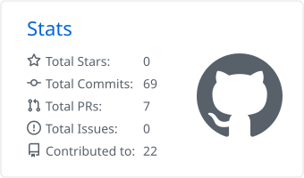
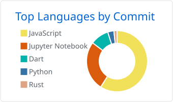

## About

I build things that sit between hardware, machine learning and phones. Right now that means a liveness and deepfake detector that combines sensor challenges with a vision ensemble, an IoT stack that runs from embedded control to AI, and a few apps I want to use myself.

- Working on **DETECT** (presentation-attack and deepfake detection) and **WIMS** (IoT with embedded control and AI)
- Shipped **ClimaFitAI**, an outfit recommender driven by live weather, and **Loop Jar**, a marble puzzle game for phones
- Day to day in Python, Dart/Flutter, JavaScript and C++

## Stack

  

## Featured projects

| Project | What it does |
| --- | --- |
| [**DETECT**](https://github.com/RamyAkin/DETECT) | Decides whether the face on camera is a real person who is physically present. Three independent checks, fused with `min()` so any one can veto. |
| [**ClimaFitAI**](https://github.com/RamyAkin/ClimaFitAI-public) | Recommends outfits from real-time weather and your personal style. [Live site](https://climafitai.web.app/). |
| [**FlashBoard**](https://github.com/RamyAkin/FlashBoard) | Turns lecture PDFs into spaced-repetition flashcards and quizzes with leaderboards, for university exam prep. |
| [**Loop Jar**](https://github.com/RamyAkin/loop-jar-app) | A marble puzzle for phones. Draw chalk loops around same-colored marbles before the jar fills. Capacitor, Android and iOS. |
| [**WIMS**](https://github.com/RamyAkin/WIMS) | An IoT solution joining embedded control, end-to-end data flow and AI. |

## Stats

  <picture>
    <source media="(prefers-color-scheme: dark)" srcset="https://raw.githubusercontent.com/RamyAkin/RamyAkin/main/profile-summary-card-output/github_dark/3-stats.svg" />
    
  </picture>
  <picture>
    <source media="(prefers-color-scheme: dark)" srcset="https://raw.githubusercontent.com/RamyAkin/RamyAkin/main/profile-summary-card-output/github_dark/2-most-commit-language.svg" />
    
  </picture>

## Activity

  <picture>
    <source media="(prefers-color-scheme: dark)" srcset="https://streak-stats.demolab.com?user=RamyAkin&theme=tokyonight&hide_border=true" />
    
  </picture>

## Contribution snake

<picture>
  <source media="(prefers-color-scheme: dark)" srcset="https://raw.githubusercontent.com/RamyAkin/RamyAkin/output/github-snake-dark.svg" />
  <source media="(prefers-color-scheme: light)" srcset="https://raw.githubusercontent.com/RamyAkin/RamyAkin/output/github-snake.svg" />
  
</picture>

