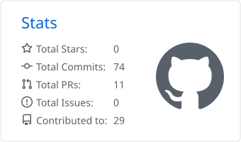
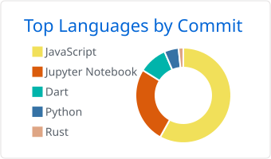

## About

I'm a software engineer with a First-Class BSc from the University of Lancashire (2026), working across AI, data and mobile. I like projects that carry a feature from the first prototype all the way to something people can install and use.

- **Now:** building **Loop Jar**, a marble puzzle game for iOS, iPad and Android, as an independent project under DZired Games
- **Also on the bench:** a self-hosted local LLM setup with Ollama, and a vision inspection pipeline in Python and OpenCV
- **Past work:** a deepfake-detection research project, an IoT water-quality sensor pipeline, and a few hackathon apps (FlashBoard placed second overall)
- **Languages:** English, French and Arabic fluently, Italian at a working level
- **Open to:** graduate roles in AI, mobile development and data engineering. UK Graduate Visa valid until September 2028.

## Stack

  

## Featured projects

| Project | What it is |
| --- | --- |
| [**narwhals**](https://github.com/narwhals-dev/narwhals) | A lightweight compatibility layer that lets one dataframe API run on pandas, Polars, PyArrow and other backends. I added `Series.from_arrow`, which is merged. |
| [**ClimaFitAI**](https://github.com/RamyAkin/ClimaFitAI-public) | A cross-platform Flutter app that recommends outfits from live weather and personal style. [Live site](https://climafitai.web.app/). |
| [**FlashBoard**](https://github.com/RamyAkin/FlashBoard) | Turns lecture PDFs into spaced-repetition flashcards and quizzes. Built in 48 hours at a university hackathon. First for complexity, second overall. |
| [**WIMS**](https://github.com/RamyAkin/WIMS) | An IoT water-quality sensor pipeline, from ESP32 firmware through PostgreSQL to a Node.js and React dashboard. |
| [**DETECT**](https://github.com/RamyAkin/DETECT) | A research project on deepfake and liveness detection, combining sensor challenges with a vision ensemble. |

## Open source

| Project | Contributions |
| --- | --- |
| [**narwhals**](https://github.com/narwhals-dev/narwhals) | [`Series.from_arrow` and `Series.__arrow_c_array__`](https://github.com/narwhals-dev/narwhals/pull/4122) (merged). [Docs for the `time_unit_compat` test helper](https://github.com/narwhals-dev/narwhals/pull/4158) (in review). |
| [**drift**](https://github.com/simolus3/drift) | [Postgres migration tooling in the docs](https://github.com/simolus3/drift/pull/3900), co-authored with the maintainer (landed). |
| [**xarray**](https://github.com/pydata/xarray) | [User-guide fix for how MultiIndex levels print](https://github.com/pydata/xarray/pull/11888) (merged). |
| [**Flutter**](https://github.com/flutter/flutter) | [macOS xcfilelists at project setup](https://github.com/flutter/flutter/pull/195692) and [a `flutter doctor` check for libstdc++ on Linux](https://github.com/flutter/flutter/pull/195705) (in review). |

## Stats

  <picture>
    <source media="(prefers-color-scheme: dark)" srcset="https://raw.githubusercontent.com/RamyAkin/RamyAkin/main/profile-summary-card-output/github_dark/3-stats.svg" />
    
  </picture>
  <picture>
    <source media="(prefers-color-scheme: dark)" srcset="https://raw.githubusercontent.com/RamyAkin/RamyAkin/main/profile-summary-card-output/github_dark/2-most-commit-language.svg" />
    
  </picture>

## Activity

  <picture>
    <source media="(prefers-color-scheme: dark)" srcset="https://streak-stats.demolab.com?user=RamyAkin&theme=tokyonight&hide_border=true" />
    
  </picture>

## Contribution snake

<picture>
  <source media="(prefers-color-scheme: dark)" srcset="https://raw.githubusercontent.com/RamyAkin/RamyAkin/output/github-snake-dark.svg" />
  <source media="(prefers-color-scheme: light)" srcset="https://raw.githubusercontent.com/RamyAkin/RamyAkin/output/github-snake.svg" />
  
</picture>

